<picture>
  <source media="(prefers-color-scheme: dark)" srcset="./assets/banner-dark.svg">
  
</picture>

  

  
  
  
  

## 👋 Hey, I'm Jerome

Full-stack engineer with five years across Node.js, TypeScript and React. I build the parts of a product that are expensive to get wrong: **commission ledgers**, **message delivery state**, and **AI pipelines with a human sign-off**. I usually own them from schema to deploy pipeline, often as the only engineer on them.

Most of my work lives in private client repositories, so every number on this page comes from `git blame`, `git log` or the system's own records, never from an estimate.

## 🤖 Building with AI

| System | What the model does | What keeps it honest | Built with |
| --- | --- | --- | --- |
| **Sales extraction** · [FVATeam](https://jeromezarate.vercel.app/work/fvateam) | GPT-4o vision reads revenue screenshots into structured sales records | A 0–1 confidence per field, a traffic-light review form, and an operator's approval before anything reaches the ledger. Manual entry stays as the fallback | OpenAI · Zod · Cloudinary |
| **Blog Bot** · [FVATeam](https://jeromezarate.vercel.app/work/fvateam) | Claude drafts posts from the least-used keywords; DALL-E 3 draws the banner | A deterministic AI-pattern checker with up to two targeted rewrites, nine durable Upstash Workflow steps that outlast Vercel's 60-second limit, and publish-or-draft as a setting | Claude · Upstash Workflow · QStash |
| **Reply orchestration** · [OnlyTool](https://jeromezarate.vercel.app/work/onlytool) | A separate AI inference service answers inbound conversations; I built the orchestration around it | Inbound webhooks land in durable pg-boss queues, so AI-service slowdowns retry instead of dropping conversations; revenue is attributed to AI or human senders | NestJS · pg-boss · Socket.IO |
| **My agent team** · team-starter | A Claude Code team plans, builds, tests, reviews and verifies changes in my own repositories | Tests seen failing before the build starts, and hooks that refuse a "done" report without evidence (below) | Claude Code · hooks · skills |

## 🧭 How I build

I build my own projects with a Claude Code team I set up: a lead session and nine agents with fixed scopes. A builder, a test engineer who only writes tests, QA that checks the running app and writes no code, a security reviewer who tries to abuse each change, a code reviewer, a designer, an architect, a tech lead and DevOps. The rules are what make it work:

- **Tests first.** The test engineer writes the tests from the acceptance criteria, the lead sees them fail, and only then does the builder start. The builder may never edit, skip or loosen a test.
- **Mockup first.** A screen is built only from a mockup I approved in a design round.
- **Claims are not evidence.** Anything one agent hands another is marked unverified. Reviewers get the diff and the gate output, never the builder's word.
- **Hooks with teeth.** A stop hook refuses a "Done" report while the run note has an unticked criterion or an empty verification section. Another sends an agent back if its report doesn't say what it didn't check.
- **Architecture in the linter.** ESLint encodes the layering rules the agents follow, so neither a person nor an agent crosses a boundary unnoticed.

I don't quote a speed-up for any of this, because I haven't measured one. What I can show is the gates.

## 💻 Tech stack

**Languages and runtime** 

**Frontend** 

**Backend and data** 

**AI and background jobs** 

**Testing and delivery** 

## 🛠️ What I specialize in

- **Ledgers and billing that stay correct.** Append-only balances with no stored balance column, reconciliation that emits adjustments instead of rewriting history, invoicing and payment webhooks.
- **Realtime messaging and mobile sync.** Per-topic sequence numbers with a per-user cursor, idempotent sends, per-recipient delivery state, transaction-aware read replicas.
- **AI features with a human in the loop.** Confidence scores, approval before any write, durable multi-step pipelines on serverless.
- **Whole products, shipped alone.** Schema, API, UI, CI gates and release discipline, with more test code than application code when it matters.

## 💼 Experience

| Role | Company | When | Work |
| --- | --- | --- | --- |
| Full-Stack Engineer (Contract) | Nexacore Innovations FZCO | Apr 2025 – Aug 2026 | FVATeam · FVAChatting · Skillura |
| Full-Stack Engineer (Contract) | Fansvine | Jan 2026 – Jul 2026, in parallel | OnlyTool |
| Software Engineer | Armadalogics | Feb 2024 – May 2025, part-time to Aug 2025 | Trilloan |
| Junior Software Engineer | Village88, Inc. | Dec 2020 – Jan 2024 | Coding Dojo · Hacker Hero · Questionary |

## 📌 Featured work

| Project | What it is | My part | Stack |
| --- | --- | --- | --- |
| [**FVATeam**](https://jeromezarate.vercel.app/work/fvateam) | Agency operations and billing platform | About half of a 77,000-line codebase: invoicing and payments, the append-only ledger and its reconciliation engine, bulk email, two AI features | Next.js · Prisma · PostgreSQL · Claude · GPT-4o |
| [**Trilloan**](https://jeromezarate.vercel.app/work/trilloan) | Fintech super-app | Opened and owned the chat service: mobile sync, per-recipient delivery state, group chat, replica routing | Node.js · Express · MySQL · Kafka · Socket.IO · React Native |
| [**OnlyTool**](https://jeromezarate.vercel.app/work/onlytool) | Multi-tenant SaaS between a platform gateway and an AI service | All backend services, frontend surfaces and CI, with tests gating every PR | NestJS · Prisma · pg-boss · Socket.IO · Next.js |
| [**Scone Willow Tree Hotel**](https://github.com/devjayzee/Scone-Willow-Tree-Hotel) | Hotel management system, live at a working hotel | Everything, solo: 261 pull requests, 1,374 tests, lint-enforced layering, ten Redis rate limiters | Next.js 16 · Prisma 7 · NextAuth · Upstash |
| [**FVAChatting**](https://fvachatting.com) | Lead-generation site and funnel | Server-side Meta Conversions API, the lead pipeline, exit-intent capture, a custom CAPTCHA | Next.js · Prisma · Resend · Twilio |
| [**Skillura**](https://skillura.com) | Training and onboarding SaaS | Agency dashboard and pipeline analytics, single sign-in, the trial-plan system, billing history | Node.js · Express · MongoDB · React |

<b>Earlier work at Village88</b>

 

| Project | What it is | My part |
| --- | --- | --- |
| [**Hacker Hero**](https://jeromezarate.vercel.app/work/hacker-hero) | Gamified learn-to-code platform | A 112-commit rebuild into one AJAX content shell with a staged-rollout permalink migration; a performance and data-integrity sprint |
| [**Coding Dojo**](https://jeromezarate.vercel.app/work/coding-dojo) | Bootcamp learning platform | The Admin Student Access module across 441 commits; the HubSpot integration that replaced Zapier |
| **Questionary** | Assessment platform | The comment and reaction subsystem, and an encrypted database-ID primitive five other engineers adopted |
| **Blockchain analytics crawler** | Multi-chain explorer scraper | The scraping engine and the whole persistence layer |

## 📊 By the numbers

| | | Source |
| --- | --- | --- |
| **$338K** | invoiced in a billing system's first month, 99% collected | the system's records |
| **~50%** | of a 77,000-line agency platform | `git blame` |
| **55% · 89%** | of a fintech chat service's production code · of its tests | `git blame` |
| **1,374** | tests in a solo-built hotel system, across 261 pull requests | the test suite, PR history |
| **733** | commits across five Node.js and React platforms | `git log` |
| **5 years** | of Node.js, TypeScript and React | |

## 📈 Activity

<picture>
  <source media="(prefers-color-scheme: dark)" srcset="https://streak-stats.demolab.com/?user=devjayzee&hide_border=true&background=16130F&stroke=37322D&ring=FCBE54&fire=FCBE54&currStreakNum=F2F0EC&sideNums=F2F0EC&currStreakLabel=FCBE54&sideLabels=B5B0AA&dates=8D8883">
  
</picture>

<picture>
  <source media="(prefers-color-scheme: dark)" srcset="https://github-readme-activity-graph.vercel.app/graph?username=devjayzee&bg_color=16130f&color=b5b0aa&title_color=f2f0ec&line=71dcd6&point=fcbe54&area=true&area_color=71dcd6&hide_border=true&custom_title=Contributions%2C%20last%2031%20days">
  
</picture>

Most of these contributions are to private repositories.

## 📬 Get in touch

Open to remote full-time roles and contract work: backend-heavy full-stack, billing and ledger systems, realtime messaging, and AI features that need a human in the loop. Philippines, UTC+8.

The fastest way to reach me is [email](mailto:jeromedzarate@gmail.com). The case studies on my [portfolio](https://jeromezarate.vercel.app) explain each system and the decisions behind it.

