<a href="https://jeromezarate.vercel.app">
<picture>
  <source media="(max-width: 600px) and (prefers-color-scheme: dark)" srcset="./assets/banner-narrow-dark.svg">
  <source media="(max-width: 600px)" srcset="./assets/banner-narrow-light.svg">
  <source media="(prefers-color-scheme: dark)" srcset="./assets/banner-dark.svg">
  
</picture>
</a>

  

  
  
  
  

  <a href="#work">Work</a> · <a href="#by-the-numbers">Numbers</a> · <a href="#how-i-work">How I work</a> · <a href="#experience">Experience</a> · <a href="#tech-stack">Stack</a> · <a href="#activity">Activity</a> · <a href="#contact">Contact</a>

## 👋 Hey, I'm Jerome

I build the parts of a product that are expensive to get wrong: **commission ledgers**, **message delivery state**, and **AI pipelines with a human sign-off**. Five years across Node.js, TypeScript and React. I own products from database schema to deploy pipeline, often as the only engineer on them.

Most of my recent work has been on teams of one or two, so I make decisions I'll still be comfortable with in six months: an append-only ledger instead of a mutable balance, five message states instead of one, a migration with a staged-rollout flag instead of one transaction you either commit or panic about.

That work lives in private client repositories, so every number on this page comes from `git blame`, `git log` or the system's own records.

<table>
<tr><td><b>Role</b></td><td>Full-stack engineer: Node.js, TypeScript, React</td></tr>
<tr><td><b>Experience</b></td><td>Five years of production systems, since December 2020</td></tr>
<tr><td><b>Education</b></td><td>Electronics and Communication Engineering, Saint Louis University, Baguio; then Village88's backend training programme</td></tr>
<tr><td><b>Based in</b></td><td>Philippines, UTC+8, working remotely</td></tr>
<tr><td><b>Open to</b></td><td>Remote full-time engineering roles and select contract work</td></tr>
<tr><td><b>Contact</b></td><td><a href="mailto:jeromedzarate@gmail.com">jeromedzarate@gmail.com</a> · <a href="https://jeromezarate.vercel.app">Portfolio</a> · <a href="https://linkedin.com/in/jerome-zarate-1403831a1">LinkedIn</a></td></tr>
</table>

<picture><source media="(prefers-color-scheme: dark)" srcset="./assets/sec-01-dark.svg"></picture>

## Work

Five systems, each with a case study on the [portfolio](https://jeromezarate.vercel.app/#work), and one open-source product.

<table>
<tr>
<td width="50%" valign="top">

**01 · [Trilloan](https://jeromezarate.vercel.app/work/trilloan)** 
FINTECH SUPER-APP

Wrote 55% of the message service inside a fintech super-app, including the group chat system end to end on the server.

**Stack**: TypeScript · Node.js · Express · MySQL · Kafka · Socket.IO · React Native · AWS S3

[Read the case study →](https://jeromezarate.vercel.app/work/trilloan)

</td>
<td width="50%" valign="top">

**02 · [FVATeam](https://jeromezarate.vercel.app/work/fvateam)** 
AGENCY OPERATIONS PLATFORM

Built the commission ledger and invoicing system that moves money between agency clients and the platform they run on.

**Stack**: Next.js 14 · TypeScript · PostgreSQL · Prisma · Claude API · GPT-4o Vision · Upstash Workflow

[Read the case study →](https://jeromezarate.vercel.app/work/fvateam) · [Live site](https://fvateam.com)

</td>
</tr>
<tr>
<td width="50%" valign="top">

**03 · [OnlyTool](https://jeromezarate.vercel.app/work/onlytool)** 
MULTI-TENANT SAAS PLATFORM

Sole engineer on a real-time platform that lets agency teams share one inbox, and lets an AI work it alongside them.

**Stack**: NestJS · TypeScript · PostgreSQL · Prisma · Socket.IO · pg-boss · Next.js · Docker

[Read the case study →](https://jeromezarate.vercel.app/work/onlytool) · [Live site](https://onlytool.ai)

</td>
<td width="50%" valign="top">

**04 · [Hacker Hero](https://jeromezarate.vercel.app/work/hacker-hero)** 
LEARN-TO-CODE PLATFORM

Rebuilt the core learning experience of a live platform across 112 commits, without a downtime window.

**Stack**: Node.js · Express · MySQL · jQuery/EJS · Mocha/Chai

[Read the case study →](https://jeromezarate.vercel.app/work/hacker-hero)

</td>
</tr>
<tr>
<td width="50%" valign="top">

**05 · [Coding Dojo](https://jeromezarate.vercel.app/work/coding-dojo)** 
BOOTCAMP LEARNING PLATFORM

Removed a third-party dependency from a student data pipeline by writing the CRM integration it was standing in for.

**Stack**: Node.js · Express · MySQL · React · Redux · HubSpot API · Jenkins

[Read the case study →](https://jeromezarate.vercel.app/work/coding-dojo)

</td>
<td width="50%" valign="top">

**OSS · [Scone Willow Tree Hotel](https://github.com/devjayzee/Scone-Willow-Tree-Hotel)** 
HOTEL MANAGEMENT SYSTEM

Built and launched it alone for a working hotel: 261 pull requests, 1,374 tests, layering enforced by the linter.

**Stack**: Next.js 16 · Prisma 7 · NextAuth · TanStack Query · Upstash · Vitest · Playwright

[Source on GitHub →](https://github.com/devjayzee/Scone-Willow-Tree-Hotel)

</td>
</tr>
</table>

<b>Earlier work</b> (Skillura, FVAChatting, Questionary, a blockchain crawler)

 

| Project | What I built |
| --- | --- |
| **Skillura** | Employee training and onboarding SaaS, on a team of 20+. Built the agency dashboard and pipeline analytics, a single sign-in for agency admins and employees, the trial-plan system, billing history, and a scheduled signup report to Google Sheets |
| **FVAChatting** | Lead-generation site sharing a database with FVATeam. Server-side conversion tracking through the Meta Conversions API with hashed identifiers and shared event-ID deduplication, exit-intent capture on a custom scroll-velocity hook, and the lead pipeline behind them |
| **Questionary** | Assessment platform. Built the comment and reaction subsystem, with one query that assembles a whole thread, authors, avatars, per-emoji counts and "did I react" flags in a single round trip, and the encrypted database-ID primitive five other engineers' modules adopted |
| **Blockchain analytics crawler** | Built the HTML scraping engine and the entire MySQL persistence layer from zero: connection config, a parameterised base model, and the schema migration with foreign keys and indexes |

<picture><source media="(prefers-color-scheme: dark)" srcset="./assets/sec-02-dark.svg"></picture>

## By the numbers

<picture>
  <source media="(max-width: 600px) and (prefers-color-scheme: dark)" srcset="./assets/metrics-narrow-dark.svg">
  <source media="(max-width: 600px)" srcset="./assets/metrics-narrow-light.svg">
  <source media="(prefers-color-scheme: dark)" srcset="./assets/metrics-dark.svg">
  
</picture>

<b>Where each number comes from</b>

 

| Number | What it measures | Source |
| --- | --- | --- |
| **5 years** | Shipping production systems since December 2020, from large team codebases to teams of one | Employment history |
| **$338K** | Invoiced through the billing platform from my first month on it, 99% collected | The platform's own records |
| **55%** | Of a fintech super-app's message service: 7,276 of 13,196 source lines, and 89% of its tests | `git blame` on the service |
| **1,374** | Tests on a hotel system I built alone, more test code than application code | The test suite |

<picture><source media="(prefers-color-scheme: dark)" srcset="./assets/sec-03-dark.svg"></picture>

## How I work

### AI with a human sign-off

| System | What the model does | What keeps it honest |
| --- | --- | --- |
| **Sales extraction** · FVATeam | GPT-4o vision reads revenue screenshots into structured sales records | A 0–1 confidence per field, a traffic-light review form, and an operator's approval before anything reaches the ledger. Manual entry stays as the fallback |
| **Blog Bot** · FVATeam | Claude drafts posts from the least-used keywords; DALL-E 3 draws the banner | A deterministic AI-pattern checker with up to two targeted rewrites, nine durable Upstash Workflow steps that outlast Vercel's 60-second limit, and publish-or-draft as a setting |
| **Shared inbox** · OnlyTool | An AI works the inbox alongside the agency team, through a separate inference service | Inbound webhooks land in durable pg-boss queues, so an upstream slowdown retries instead of dropping a conversation; every sale is attributed to the AI or a human sender |

### The team I build with

<picture>
  <source media="(max-width: 600px) and (prefers-color-scheme: dark)" srcset="./assets/flow-narrow-dark.svg">
  <source media="(max-width: 600px)" srcset="./assets/flow-narrow-light.svg">
  <source media="(prefers-color-scheme: dark)" srcset="./assets/flow-dark.svg">
  
</picture>

My own projects are built by a Claude Code team I set up: a lead session and nine agents with fixed scopes. A builder, a test engineer who only writes tests, QA that checks the running app and writes no code, a security reviewer who tries to abuse each change, a code reviewer, a designer, an architect, a tech lead and DevOps. The rules are what make it work:

- **Tests first.** The test engineer writes the tests from the acceptance criteria, the lead sees them fail, and only then does the builder start. The builder may never edit, skip or loosen a test.
- **Mockup first.** A screen is built only from a mockup I approved in a design round. The portfolio's hero went through three.
- **Claims are not evidence.** Anything one agent hands another is marked unverified. Reviewers get the diff and the gate output, never the builder's word.
- **Hooks with teeth.** A stop hook refuses a "Done" report while the run note has an unticked criterion or an empty verification section. Another sends an agent back if its report doesn't say what it didn't check.
- **Architecture in the linter.** ESLint encodes the layering rules the agents follow, so neither a person nor an agent crosses a boundary unnoticed.

I don't quote a speed-up for any of this, because I haven't measured one. What I can show is the gates.

<picture><source media="(prefers-color-scheme: dark)" srcset="./assets/sec-04-dark.svg"></picture>

## Experience

<picture>
  <source media="(max-width: 600px) and (prefers-color-scheme: dark)" srcset="./assets/timeline-narrow-dark.svg">
  <source media="(max-width: 600px)" srcset="./assets/timeline-narrow-light.svg">
  <source media="(prefers-color-scheme: dark)" srcset="./assets/timeline-dark.svg">
  
</picture>

| Period | Company | Role | Work |
| --- | --- | --- | --- |
| Jan 2026 – Jul 2026 | Fansvine | Full-Stack Engineer (Contract) | OnlyTool, in parallel with Nexacore |
| Apr 2025 – Aug 2026 | Nexacore Innovations FZCO | Full-Stack Engineer (Contract) | FVATeam · FVAChatting · Skillura |
| Feb 2024 – May 2025 | Armadalogics | Software Engineer | Trilloan, then part-time to Aug 2025 |
| Dec 2020 – Jan 2024 | Village88, Inc. | Junior Software Engineer | Coding Dojo · Hacker Hero · Questionary |

<picture><source media="(prefers-color-scheme: dark)" srcset="./assets/sec-05-dark.svg"></picture>

## Tech stack

**Languages** 

**Backend** 

**Frontend** 

**Data** 

**AI and jobs** 

**Infrastructure** 

**Testing** 

<picture><source media="(prefers-color-scheme: dark)" srcset="./assets/sec-06-dark.svg"></picture>

## Activity

<picture>
  <source media="(prefers-color-scheme: dark)" srcset="https://raw.githubusercontent.com/devjayzee/devjayzee/output/activity-dark.svg">
  
</picture>

<picture><source media="(prefers-color-scheme: dark)" srcset="./assets/sec-07-dark.svg"></picture>

## Contact

<a href="mailto:jeromedzarate@gmail.com">
<picture>
  <source media="(max-width: 600px) and (prefers-color-scheme: dark)" srcset="./assets/cta-narrow-dark.svg">
  <source media="(max-width: 600px)" srcset="./assets/cta-narrow-light.svg">
  <source media="(prefers-color-scheme: dark)" srcset="./assets/cta-dark.svg">
  
</picture>
</a>

- **Email**: [jeromedzarate@gmail.com](mailto:jeromedzarate@gmail.com)
- **Portfolio**: [jeromezarate.vercel.app](https://jeromezarate.vercel.app), five case studies with the decisions behind each
- **LinkedIn**: [linkedin.com/in/jerome-zarate-1403831a1](https://linkedin.com/in/jerome-zarate-1403831a1)

<picture>
  <source media="(max-width: 600px) and (prefers-color-scheme: dark)" srcset="./assets/footer-narrow-dark.svg">
  <source media="(max-width: 600px)" srcset="./assets/footer-narrow-light.svg">
  <source media="(prefers-color-scheme: dark)" srcset="./assets/footer-dark.svg">
  
</picture>
