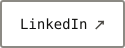

<picture>
  <source media="(prefers-color-scheme: dark)" srcset="./assets/hero-dark.svg">
  
</picture>

  <a href="mailto:jeromedzarate@gmail.com"><picture><source media="(prefers-color-scheme: dark)" srcset="./assets/button-email-dark.svg"></picture></a>
  <a href="https://jeromezarate.vercel.app"><picture><source media="(prefers-color-scheme: dark)" srcset="./assets/button-portfolio-dark.svg"></picture></a>
  <a href="https://linkedin.com/in/jerome-zarate-1403831a1"><picture><source media="(prefers-color-scheme: dark)" srcset="./assets/button-linkedin-dark.svg"></picture></a>

<picture>
  <source media="(prefers-color-scheme: dark)" srcset="./assets/metrics-dark.svg">
  
</picture>

## Work

Five systems, each with a case study on the [portfolio](https://jeromezarate.vercel.app/#work), and one open-source product.

| | System | What I built | Stack |
| --- | --- | --- | --- |
| 01 | [**Trilloan**](https://jeromezarate.vercel.app/work/trilloan) · Fintech super-app | Wrote 55% of the message service inside a fintech super-app, including the group chat system end to end on the server | TypeScript · Node.js · Express · MySQL · Kafka · Socket.IO · React Native · AWS S3 |
| 02 | [**FVATeam**](https://jeromezarate.vercel.app/work/fvateam) · Agency operations platform | Built the commission ledger and invoicing system that moves money between agency clients and the platform they run on | Next.js 14 · TypeScript · PostgreSQL · Prisma · Claude API · GPT-4o Vision · Upstash Workflow |
| 03 | [**OnlyTool**](https://jeromezarate.vercel.app/work/onlytool) · Multi-tenant SaaS platform | Sole engineer on a real-time platform that lets agency teams share one inbox, and lets an AI work it alongside them | NestJS · TypeScript · PostgreSQL · Prisma · Socket.IO · pg-boss · Next.js · Docker |
| 04 | [**Hacker Hero**](https://jeromezarate.vercel.app/work/hacker-hero) · Learn-to-code platform | Rebuilt the core learning experience of a live platform across 112 commits, without a downtime window | Node.js · Express · MySQL · jQuery/EJS · Mocha/Chai |
| 05 | [**Coding Dojo**](https://jeromezarate.vercel.app/work/coding-dojo) · Bootcamp learning platform | Removed a third-party dependency from a student data pipeline by writing the CRM integration it was standing in for | Node.js · Express · MySQL · React · Redux · HubSpot API · Jenkins |
| OSS | [**Scone Willow Tree Hotel**](https://github.com/devjayzee/Scone-Willow-Tree-Hotel) · Hotel management system | Built and launched it alone for a working hotel: 261 pull requests, 1,374 tests, layering enforced by the linter | Next.js 16 · Prisma 7 · NextAuth · TanStack Query · Upstash · Vitest · Playwright |

## How I work

### AI with a human sign-off

| System | What the model does | What keeps it honest |
| --- | --- | --- |
| **Sales extraction** · FVATeam | GPT-4o vision reads revenue screenshots into structured sales records | A 0–1 confidence per field, a traffic-light review form, and an operator's approval before anything reaches the ledger. Manual entry stays as the fallback |
| **Blog Bot** · FVATeam | Claude drafts posts from the least-used keywords; DALL-E 3 draws the banner | A deterministic AI-pattern checker with up to two targeted rewrites, nine durable Upstash Workflow steps that outlast Vercel's 60-second limit, and publish-or-draft as a setting |
| **Shared inbox** · OnlyTool | An AI works the inbox alongside the agency team, through a separate inference service | Inbound webhooks land in durable pg-boss queues, so an upstream slowdown retries instead of dropping a conversation; every sale is attributed to the AI or a human sender |

### The team I build with

My own projects are built by a Claude Code team I set up: a lead session and nine agents with fixed scopes. A builder, a test engineer who only writes tests, QA that checks the running app and writes no code, a security reviewer who tries to abuse each change, a code reviewer, a designer, an architect, a tech lead and DevOps. The rules are what make it work:

- **Tests first.** The test engineer writes the tests from the acceptance criteria, the lead sees them fail, and only then does the builder start. The builder may never edit, skip or loosen a test.
- **Mockup first.** A screen is built only from a mockup I approved in a design round. The portfolio's hero went through three.
- **Claims are not evidence.** Anything one agent hands another is marked unverified. Reviewers get the diff and the gate output, never the builder's word.
- **Hooks with teeth.** A stop hook refuses a "Done" report while the run note has an unticked criterion or an empty verification section. Another sends an agent back if its report doesn't say what it didn't check.
- **Architecture in the linter.** ESLint encodes the layering rules the agents follow, so neither a person nor an agent crosses a boundary unnoticed.

I don't quote a speed-up for any of this, because I haven't measured one. What I can show is the gates.

## Experience

| Period | Company | Role | Work |
| --- | --- | --- | --- |
| Jan 2026 – Jul 2026 | Fansvine | Full-Stack Engineer (Contract) | OnlyTool, in parallel with Nexacore |
| Apr 2025 – Aug 2026 | Nexacore Innovations FZCO | Full-Stack Engineer (Contract) | FVATeam · FVAChatting · Skillura |
| Feb 2024 – May 2025 | Armadalogics | Software Engineer | Trilloan, then part-time to Aug 2025 |
| Dec 2020 – Jan 2024 | Village88, Inc. | Junior Software Engineer | Coding Dojo · Hacker Hero · Questionary |

## Earlier

| Project | What I built |
| --- | --- |
| **Skillura** | Employee training and onboarding SaaS, on a team of 20+. Built the agency dashboard and pipeline analytics, a single sign-in for agency admins and employees, the trial-plan system, billing history, and a scheduled signup report to Google Sheets |
| **FVAChatting** | Lead-generation site sharing a database with FVATeam. Server-side conversion tracking through the Meta Conversions API with hashed identifiers and shared event-ID deduplication, exit-intent capture on a custom scroll-velocity hook, and the lead pipeline behind them |
| **Questionary** | Assessment platform. Built the comment and reaction subsystem, with one query that assembles a whole thread, authors, avatars, per-emoji counts and "did I react" flags in a single round trip, and the encrypted database-ID primitive five other engineers' modules adopted |
| **Blockchain analytics crawler** | Built the HTML scraping engine and the entire MySQL persistence layer from zero: connection config, a parameterised base model, and the schema migration with foreign keys and indexes |

## About

> Small teams don't get to **fix things twice.**

I studied Electronics and Communication Engineering at Saint Louis University in Baguio, then spent seven months in Village88's backend training programme learning to actually build software. I've been shipping production systems since.

Most of my recent work has been on teams of one or two, which shapes how I build. I don't get to hand a schema to a backend specialist, so I've learned to make decisions I'll still be comfortable with in six months: an append-only ledger instead of a mutable balance, five message states instead of one, a migration with a staged-rollout flag instead of one transaction you either commit or panic about.

<picture>
  <source media="(prefers-color-scheme: dark)" srcset="./assets/tools-dark.svg">
  
</picture>

<picture>
  <source media="(prefers-color-scheme: dark)" srcset="https://raw.githubusercontent.com/devjayzee/devjayzee/output/activity-dark.svg">
  
</picture>

## Contact

**Let's talk about what you're building.** I'm open to remote full-time engineering roles, and to select contract work. I'm in the Philippines on UTC+8, and I overlap comfortably with European mornings and US evenings.

[jeromedzarate@gmail.com](mailto:jeromedzarate@gmail.com) · [jeromezarate.vercel.app](https://jeromezarate.vercel.app) · [LinkedIn](https://linkedin.com/in/jerome-zarate-1403831a1)
